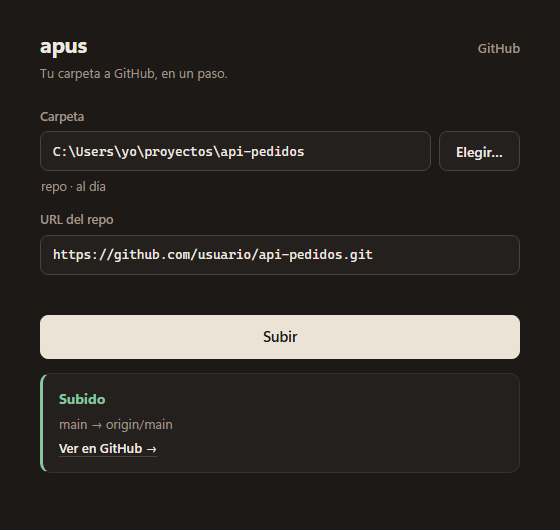

<p align="center">
  
</p>

<h1 align="center">apus</h1>

<p align="center">Tu carpeta a GitHub, en un paso.<br>Elegís una carpeta, pegás la URL del repo, y se sube todo.</p>

---

*Apus* es el género del vencejo, el ave de vuelo nivelado más rápida que existe. La herramienta hace lo mismo con tus cambios: `git init` si hace falta, `add`, `commit` y `push`, en un paso, para volver a trabajar.

Corre en Windows, Linux y macOS. Es un solo binario, sin dependencias más allá de `git`.

En este repo también vive [**Apus affinis**](extension/), la extensión de VS Code que usa apus para subir sola cuando dejás de tocar el repo.

## La ventana

<p align="center">
  
</p>

1. **Carpeta**: la escribís o tocás **Elegir…** para abrir el selector del sistema.
2. **URL del repo**: la pegás. Si la carpeta ya tenía remoto, aparece sola.
3. **Subir**.

Por detrás, apus inicializa el repo si la carpeta no lo era, pone esa URL como `origin`, hace `add -A`, un commit con mensaje automático y el push.

Tiene estos cuidados:

- Antes de tocar nada pasa **apus-guard**, que busca secretos en lo que se va a subir (ver abajo). Si encuentra uno crítico, no sube nada.
- Si GitHub rechaza el push porque tiene commits que tu carpeta no tiene (por ejemplo, creaste el repo con README), no te deja con el error de git:
  - trae lo del remoto y ensaya el merge sin tocar tu carpeta;
  - si no choca nada, te ofrece **Traer y continuar**, y sube;
  - si hay archivos que cambiaron en los dos lados, te los muestra y te deja elegir: **Traer cambios remotos (rebase)**, para resolver los choques en tu editor y tocar **Continuar**, o **Sobrescribir remoto (force push)**, con una advertencia aparte. Nunca es lo que pasa por defecto, y solo pisa lo que viste: si GitHub cambió mientras decidías, no pisa nada;
  - si quedaste a mitad de resolver, al volver a abrir la carpeta te muestra qué falta, con **Continuar** y **Cancelar y dejar todo como estaba**.
- Si la carpeta apuntaba a otro remoto y pegás una URL distinta, te avisa antes de subir.
- Si elegís una subcarpeta de otro repo, no sube el repo de afuera.
- Recuerda la última carpeta.
- Se cierra sola cuando cerrás la ventana.

En Windows la ventana es `apusw.exe`, que no abre terminal: ni la suya ni la de cada `git`. Si algo falla antes de abrir, muestra el error en un cuadro de diálogo. La ventana sigue el tema claro u oscuro del sistema.

## apus-guard

Revisa lo que "Subir" va a mandar: los archivos nuevos y los que cambiaron desde el último push, sin los que ignora `.gitignore`. Las reglas son fijas y apuntan a .NET y Azure:

| Qué busca | Dónde | Severidad |
|---|---|---|
| `Password=` / `Pwd=` en un connection string de SQL Server | `appsettings*.json` | crítico |
| `User ID=` en un connection string sin contraseña a la vista | `appsettings*.json` | aviso |
| `AccountKey=` (Azure Storage), `SharedAccessKey=` (Service Bus, Event Hubs) | appsettings, `.cs`, `.config`, `.yml`, `.env` y otros de texto | crítico |
| Claves con nombre de secreto (`ApiKey`, `ClientSecret`, `Secret`, `Token`, `Password`) con un valor escrito | `appsettings*.json` | crítico |
| `ClientId` con un valor escrito | `appsettings*.json` | aviso |
| Connection strings de SQL Server armados en el código | `.cs` | crítico con contraseña, si no aviso |

- **Cada hallazgo muestra** el archivo, la línea, la severidad, el valor tapado (un prefijo corto y `****`, nunca el secreto entero) y qué hacer: `dotnet user-secrets` con la clave exacta, la variable de entorno equivalente, Azure Key Vault o Managed Identity, según el caso.
- **No marca relleno:** valores vacíos, `CHANGE_ME`, `<password>`, `${DB_PASSWORD}`, `#{Token}#`, referencias de Key Vault (`@Microsoft.KeyVault(...)`), la clave pública del emulador de Storage, ni connection strings con `Integrated Security` o Managed Identity.
- **Para ignorar una línea** que no es un secreto, agregale el comentario `apus-guard:ignore`, o marcala como ignorada en [Aerodramus](#aerodramus).
- Los **avisos** se muestran, pero no frenan la subida.

Desde la terminal: `apus guard` revisa la carpeta actual, y `apus guard --json` devuelve los hallazgos en JSON.

**Issues en GitHub.** En la ventana, tocá **GitHub** y guardá un token con permiso de *Issues* (lectura y escritura). Cuando apus-guard frena una subida a un repo de GitHub, abre un issue por cada hallazgo crítico: archivo, línea, severidad, la línea tapada y qué hacer. Antes de abrirlo se fija si ya hay uno abierto para ese archivo, línea y regla, así no se repite. El token va al llavero del sistema (el Administrador de credenciales en Windows, el Llavero en macOS, Secret Service en Linux): nunca a un archivo, y nunca aparece en la ventana ni en un log.

**Chequeo en los pull requests.** En **GitHub → Agregar a este repo** (o `apus guard init`), apus deja `.github/workflows/apus-guard.yml` en la carpeta. En cada PR baja la misma versión de apus, verifica su SHA-256 y corre las mismas reglas sobre las líneas que agrega el PR. Comenta cada hallazgo en su línea, como comentario de revisión, y falla el check si hay algo crítico. Para que eso bloquee el merge, pedí el check `apus-guard / guard` en la protección de la rama.

## Aerodramus

Cada vez que apus-guard revisa una carpeta, anota lo que encontró en un log de esta máquina, fuera de los repos: `%LOCALAPPDATA%\apus\guard-log.json` en Windows, `~/.local/state/apus/guard-log.json` en Linux y `~/Library/Application Support/apus/guard-log.json` en macOS. Como la ventana, guarda el valor tapado, nunca el secreto.

**Aerodramus** es la ventana para revisar ese log: los hallazgos de todos tus repos, agrupados por repo, con su severidad y su estado (pendiente, resuelto o ignorado). Por cada uno podés abrir el archivo en la línea exacta (en VS Code, si está instalado), copiar el arreglo, marcarlo resuelto o ignorarlo. Lo ignorado deja de frenar la subida, y lo que sacás del código se da por resuelto la próxima vez que apus-guard revisa ese archivo.

Se abre desde el menú Inicio (o el de aplicaciones en Linux) o con `apus aerodramus`. No frena nada ni se conecta a ningún lado: solo lee y escribe el log.

## La terminal

Dentro de un repo que ya tiene remoto:

```bash
apus                        # add + commit (mensaje automático) + push
apus "fix: arreglo bug X"   # con mensaje propio
apus -n                     # muestra lo que haría, sin hacerlo
apus status                 # estado de los repos de la carpeta actual
apus ui                     # abre la ventana
apus guard                  # busca secretos en lo que se subiría (apus-guard)
apus aerodramus             # abre Aerodramus, para revisar lo que encontró apus-guard
apus install                # instala apus para tu usuario (y apus uninstall lo saca)
```

| Opción | Qué hace |
|---|---|
| `-m, --message <msg>` | Mensaje de commit (igual que el argumento posicional). |
| `-n, --dry-run` | Muestra los comandos sin ejecutar nada. |
| `-q, --quiet` | Silencia la salida. |
| `--json` | Al terminar, una línea JSON en stdout con el desenlace. Para programas: nunca pregunta nada. |
| `-h, --help` | Ayuda. |
| `-V, --version` | Versión. |

Si la carpeta no es un repo, ofrece iniciarla. Si la rama nunca se publicó, hace `git push -u`. Para la terminal, el remoto lo ponés vos una vez con `git remote add origin <url>`.

## Instalación

### Windows

Bajá [`apusw.exe`](https://github.com/miguelacaceresrios/Apus/releases/latest/download/apusw.exe) y abrilo. Te pregunta si querés instalarlo. Decí que sí y listo:

- queda en el menú Inicio y en el escritorio, con su ícono;
- `apus` funciona en cualquier terminal nueva;
- se desinstala desde *Configuración → Aplicaciones instaladas*, como cualquier programa.

No pide permisos de administrador: todo queda en tu usuario, en `%LOCALAPPDATA%\Programs\apus`. Cuando bajes una versión nueva y la abras, te ofrece actualizar la instalada.

Los binarios no están firmados, así que la primera vez SmartScreen puede frenarlo: *Más información → Ejecutar de todos modos*.

Si preferís la terminal, esto hace lo mismo sin pasar por SmartScreen:

```powershell
irm https://raw.githubusercontent.com/miguelacaceresrios/Apus/master/scripts/install.ps1 | iex
```

### Linux y macOS

```bash
curl -fsSL https://raw.githubusercontent.com/miguelacaceresrios/Apus/master/scripts/install.sh | sh
```

Queda en `~/.local/bin/apus` y, en Linux, en el menú de aplicaciones con su ícono. Para sacarlo: `apus uninstall`.

El selector de carpetas usa `zenity` o `kdialog` en Linux, y el nativo en Windows y macOS.

### A mano

Cada versión trae los binarios en [Releases](https://github.com/miguelacaceresrios/Apus/releases/latest), para Windows (x64 y ARM), Linux y macOS (Intel y Apple Silicon). Cualquiera se instala solo con `apus install`, y cada release trae `SHA256SUMS.txt` para verificar la descarga (`Get-FileHash` en Windows, `sha256sum` en Linux y macOS).

### Compilar

Hace falta [Go 1.25](https://go.dev/dl/).

```powershell
git clone https://github.com/miguelacaceresrios/Apus apus
cd apus
.\scripts\build.ps1 -Install    # compila e instala esta versión
```

En Linux y macOS: `make build && dist/apus install`.

**Solo la versión en Bash**

[`scripts/apus.sh`](scripts/apus.sh) es la versión original: la misma lógica de terminal en un solo archivo, sin ventana.

```bash
curl -o ~/.local/bin/apus https://raw.githubusercontent.com/miguelacaceresrios/Apus/master/scripts/apus.sh
chmod +x ~/.local/bin/apus
```

## Configuración

Variables de entorno, todas opcionales:

| Variable | Por defecto | Qué hace |
|---|---|---|
| `APUS_MESSAGE_TEMPLATE` | `chore: actualización {date}` | Plantilla del mensaje; `{date}` es la fecha y hora. |
| `APUS_DATE_FORMAT` | `%Y-%m-%d %H:%M` | Formato de la fecha, al estilo de `date`. |
| `APUS_DEFAULT_BRANCH` | `main` | Rama inicial cuando apus hace `git init`. |
| `APUS_REMOTE` | — | Remoto a usar si hay varios y ninguno se llama `origin`. |
| `APUS_REPOS_DIR` | carpeta actual | Dónde busca repos `apus status`, y dónde arranca el selector. |
| `NO_COLOR` | — | Salida sin colores. |

## Códigos de salida

| Código | Significado |
|---|---|
| `0` | Todo bien, incluido "no había nada que hacer". |
| `1` | Problema con el repo: sin remoto, HEAD desprendido, commit rechazado por un hook. |
| `2` | Uso incorrecto. |
| `3` | Falló el push. El commit ya quedó hecho: corregí y volvé a correr. |

`apus status --json` devuelve el formato de un módulo `custom` de Waybar.

## Salida JSON

Con `--json`, apus escribe los pasos en stderr como siempre y, al terminar, **una sola línea** en stdout, salga bien o mal:

```json
{"apus":"2.3.0","ok":false,"code":3,"reason":"offline",
 "summary":"el push falló: main → origin/main",
 "hint":"sin conexión con el remoto: el commit quedó guardado, volvé a correr apus cuando haya conexión",
 "committed":true,"pushed":false,"commit":"a1b2c3d",
 "branch":"main","target":"origin/main","steps":[{"cmd":"git add -A"},{"cmd":"git commit -m …","out":"…"}]}
```

| Campo | Qué es |
|---|---|
| `ok`, `code` | Si salió bien, y el código de salida. |
| `reason` | Solo si falló: `usage`, `notRepo`, `repo`, `detached`, `add`, `commit`, `noRemote`, `whichRemote`, `offline`, `auth`, `notFound`, `behind` o `push`. |
| `summary`, `hint` | Lo mismo que se ve en la terminal, en castellano. Para mostrar, no para comparar: para eso está `reason`. |
| `committed`, `pushed`, `commit` | Si hizo el commit (y cuál) y si subió. Con el código `3` el commit ya quedó hecho. |
| `branch`, `target`, `url` | La rama, a dónde subió, y la página del repo, sin usuario ni token. |
| `steps` | Cada comando de git que corrió, con lo que dijo. |

Los campos se pueden agregar en versiones nuevas, pero no cambiar. Solo el binario tiene `--json`; `apus.sh` no.

## Seguridad

La ventana es una página servida por el mismo binario en `127.0.0.1`. Cada vez que arranca genera un token. Solo atiende pedidos que traigan ese token, una cabecera propia y el `Host` exacto. Así, ninguna otra página del navegador, ni un dominio que resuelva a `127.0.0.1`, puede subir nada.

## Desarrollo

```
apus/
├── *.go                  núcleo, terminal, ventana, apus-guard, Aerodramus, GitHub e instalador
├── rsrc_windows_*.syso   ícono y versión de los .exe (los genera make icons)
├── ui/index.html         la ventana
├── ui/aerodramus.html    Aerodramus
├── assets/               el logo (apus.svg) y los íconos que salen de él
├── docs/                 imágenes del README
├── extension/            Apus affinis, la extensión de VS Code (TypeScript)
├── scripts/
│   ├── install.ps1       instalador de una línea para Windows
│   ├── install.sh        instalador de una línea para Linux y macOS
│   ├── build.ps1         compilación en Windows
│   ├── apus.sh           versión en Bash
│   └── test.sh           pruebas de la terminal
├── tools/icongen/        dibuja los íconos desde apus.svg
├── Makefile
└── CHANGELOG.md
```

**Pruebas**

```bash
make test                    # todo: vet, go test y las dos baterías de la terminal
```

En Windows, `.\scripts\build.ps1 -Test`.

- `go test` cubre la ventana (carpeta nueva, repo al día, cambio de URL, carpeta vacía, subcarpeta de otro repo, entradas inválidas), el push rechazado (traer y continuar, rebase con conflictos, continuar, cancelar, sobrescribir), apus-guard (cada regla, el relleno que no cuenta, que el secreto no se filtre), GitHub contra una API simulada (issues sin duplicar, comentarios de revisión, el workflow), el llavero de Windows, la detección del binario de ventana y la copia que usa el instalador.
- `scripts/test.sh` son 31 casos de la terminal, que corren contra `apus.sh` y contra el binario (`APUS_IMPL=go`).

Todo corre en carpetas temporales, con un repo local haciendo de GitHub, y sin tocar tu configuración de git. CI corre lo mismo en Linux y Windows.

**Íconos**: el logo es `assets/apus.svg`. `make icons` (o `go run ./tools/icongen`) lo dibuja sobre el cuadrado crema y deja `apus.ico` y `apus.png` (y los de Aerodramus, en tonos oscuros), y vuelve a generar los `.syso` con el ícono de los `.exe`. La ventana usa `apus.png`, que va adentro del binario.

Los cambios de cada versión están en [CHANGELOG.md](CHANGELOG.md).

## Licencia

[MIT](LICENSE)
